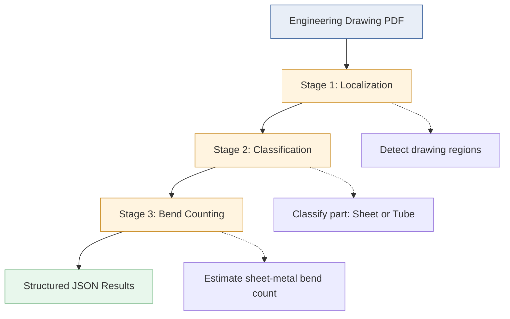

# VLM Pipeline — Manufacturing Drawing Analysis

A three-stage Vision-Language Model (VLM) pipeline for analyzing single-part engineering drawings. The system localizes important drawing regions, classifies the manufactured part as a sheet-metal component or tube, and estimates the number of sheet-metal bends.

Developed for **AAI Labs (2026)**.

The pipeline combines visual analysis, engineering drawing interpretation, and structured JSON outputs to support automated manufacturing-drawing analysis.

---

## Table of Contents

- [Pipeline Architecture](#pipeline-architecture)
- [Project Structure](#project-structure)
- [Technologies Used](#technologies-used)
- [Setup and Installation](#setup-and-installation)
- [Running the Pipeline](#running-the-pipeline)
- [Output Formats](#output-formats)
- [Reference Drawings](#reference-drawings)
- [Hardware and Performance](#hardware-and-performance)
- [Current Limitations](#current-limitations)
- [Future Improvements](#future-improvements)
- [Reproducibility](#reproducibility)
- [Project Information](#project-information)

---

## Pipeline Architecture

The system processes engineering drawings through three stages:



### Stage 1 — Drawing Region Localization

| | |
|---|---|
| **Script** | `src/localize.py` |
| **Prompt** | `prompts/localize_prompt.txt` |

Identifies important regions in an engineering drawing, such as:

- `flat_pattern`
- `orthographic_view`
- `isometric_view`
- `title_block`

The localized regions are cropped and saved for subsequent analysis.

**Outputs**

- `json/Localization/Localization.json`
- `output/localization/`

### Stage 2 — Part Classification

| | |
|---|---|
| **Script** | `src/classify.py` |
| **Prompt** | `prompts/classify_prompt.txt` |

Analyzes drawing regions and available textual evidence to classify the component.

The primary categories are:

- **Sheet** — Sheet-metal parts and flat or formed sheet components.
- **Tube** — Hollow structural profiles, including square tubes.

Classification may use information from title blocks, dimensions, material specifications, and orthographic or isometric views.

**Outputs**

- `json/Classification/Classification.json`
- `output/classify/`

### Stage 3 — Sheet-Metal Bend Counting

| | |
|---|---|
| **Script** | `src/count_bends.py` |
| **Prompt** | `prompts/count_bends_prompt.txt` |

Estimates the number of bends in a sheet-metal component using the available drawing views.

The analysis can consider:

- Bend or fold lines in flat-pattern views.
- Geometric evidence from orthographic projections.
- Isometric views that help interpret the component's shape.
- Relevant manufacturing information in the drawing.

The model returns a structured result containing the estimated bend count, confidence score, supporting evidence, and any flags.

**Outputs**

- `json/Bend_count/Bend_count.json`
- `output/count/`

> **Important:** Bend counting is intended for sheet-metal components. A hollow tube's cross-section does not, by itself, establish that the component has a sheet-metal bend. Tube classifications should therefore be handled appropriately rather than interpreted as ordinary sheet-metal bend counts.

---

## Project Structure

```text
vlm-drawing-pipeline/
├── configs/
│   └── models.yaml
│
├── docs/
│
├── images/
│   ├── Localization output (just for reference)/
│   │   ├── 001_redacted/
│   │   ├── 002_redacted/
│   │   ├── 003_redacted/
│   │   └── 004_redacted/
│   └── page_0.png
│
├── json/
│   ├── Bend_count/
│   │   └── Bend_count.json
│   ├── Classification/
│   │   └── Classification.json
│   └── Localization/
│       └── Localization.json
│
├── output/
│   ├── classify/
│   │   ├── *_classification.json
│   │   └── *_ocr.txt
│   ├── count/
│   │   ├── *_bends.json
│   │   └── *_bend_ocr.txt
│   └── localization/
│       ├── *_regions.json
│       ├── *_localized.png
│       └── cropped region images
│
├── prompts/
│   ├── classify_prompt.txt
│   ├── count_bends_prompt.txt
│   └── localize_prompt.txt
│
├── reference_samples/
│   ├── 001_redacted.pdf
│   ├── 002_redacted.pdf
│   ├── 003_redacted.pdf
│   ├── 004_redacted.pdf
│   └── Technical_Task_VLM_Drawing_Pipeline.pdf
│
├── scripts/
│   ├── run_classify.sh
│   ├── run_count.sh
│   ├── run_localize.sh
│   └── run_visualize.sh
│
├── src/
│   ├── localize.py
│   ├── classify.py
│   └── count_bends.py
│
├── Stage_1_Output_cropped_images/
├── requirements.txt
├── run_batch.sh
└── README.md
```

---

## Technologies Used

| Technology | Purpose |
|---|---|
| Python | Pipeline implementation |
| Ollama | Local model serving and inference |
| Qwen3-VL | Vision-language analysis used by the current bend-counting script |
| JSON | Structured intermediate and final results |
| Shell scripts | Running individual stages and batch processing |
| Engineering drawing PDFs | Input documents |
| Image crops | Focused analysis of drawing regions |

> The model used by each stage should be verified against `configs/models.yaml` and its corresponding Python script. The current bend-counting implementation uses `qwen3-vl:4b-instruct`.

---

## Setup and Installation

### Prerequisites

- Linux or another supported operating system.
- Python 3.10 or newer.
- Git.
- Ollama installed and running.
- Sufficient RAM and storage for local model inference.
- An NVIDIA GPU is recommended for acceleration when supported by the installed Ollama configuration.

### 1. Clone the repository

```bash
git clone https://github.com/aai-labs/vlm-drawing-pipeline.git
cd vlm-drawing-pipeline
```

> Replace the repository URL if your GitHub repository uses a different owner or name.

### 2. Create a virtual environment

```bash
python3 -m venv .venv
source .venv/bin/activate
```

### 3. Install Python dependencies

```bash
pip install --upgrade pip
pip install -r requirements.txt
```

### 4. Verify Ollama

Check that Ollama is installed:

```bash
ollama --version
```

Check whether the required model is available:

```bash
ollama list
```

If the bend-counting model is not installed, pull it:

```bash
ollama pull qwen3-vl:4b-instruct
```

Verify that Ollama responds:

```bash
ollama ps
```

The model must be available to the Python script when bend counting is executed.

---

## Running the Pipeline

### Option 1 — Run the batch script

From the project root:

```bash
./run_batch.sh
```

This is the repository's batch entry point. Check the script to confirm which stages it executes and where it expects the input drawings.

If you receive a permission error, run:

```bash
chmod +x run_batch.sh
./run_batch.sh
```

### Option 2 — Run each stage individually

The project also includes individual shell scripts.

**Stage 1: Localization**

```bash
./scripts/run_localize.sh
```

**Stage 2: Classification**

```bash
./scripts/run_classify.sh
```

**Stage 3: Bend counting**

```bash
./scripts/run_count.sh
```

Run the stages in order because later stages may depend on the intermediate files produced by earlier stages.

If necessary, inspect the scripts to determine their input paths and arguments:

```bash
cat scripts/run_localize.sh
cat scripts/run_classify.sh
cat scripts/run_count.sh
```

### Option 3 — Run Python scripts directly

The individual Python scripts can also be executed directly:

```bash
python3 src/localize.py
python3 src/classify.py
python3 src/count_bends.py
```

The current scripts may use predefined input paths rather than command-line arguments. Check each script before supplying additional arguments.

---

## Output Formats

The pipeline produces intermediate and final results in JSON format, along with OCR text and visualization artifacts.

### 1. Localization Output

**Location:** `json/Localization/Localization.json`

Contains the detected drawing regions and their associated localization information.

A region entry may contain information such as its category, bounding box, or confidence score, depending on the actual output schema.

### 2. Classification Output

**Location:** `json/Classification/Classification.json`

The current classification output follows this general structure:

```json
{
    "class": "Tube",
    "confidence": 0.98,
    "evidence": "The drawing shows a hollow square structural profile."
}
```

The example illustrates the structure of the classification result. Actual evidence and confidence values depend on the input drawing and model prediction.

### 3. Bend-Counting Output

**Location:** `json/Bend_count/Bend_count.json`

An example result produced during development:

```json
{
    "num_bends": 1,
    "bend_confidence": 0.95,
    "bend_evidence": "One bend in square tube profile",
    "flags": []
}
```

The fields represent:

| Field | Description |
|---|---|
| `num_bends` | Predicted number of bends |
| `bend_confidence` | Model-reported confidence |
| `bend_evidence` | Textual explanation of the prediction |
| `flags` | Issues or qualifications reported by the model |

> **Note:** The example above records an actual model prediction, not a verified ground-truth result. In particular, the predicted bend count for a tube should not be treated as a valid sheet-metal bend count without additional evidence.

---

## Reference Drawings

The `reference_samples/` directory contains the engineering drawing PDFs used during development.

| Drawing | Description | Intended analysis |
|---|---|---|
| `001_redacted.pdf` | Engineering drawing | Region localization, classification, and bend analysis |
| `002_redacted.pdf` | Engineering drawing | Region localization and part classification |
| `003_redacted.pdf` | Engineering drawing | Tube or structural-profile recognition |
| `004_redacted.pdf` | Engineering drawing | Part classification and geometric interpretation |

The `images/` directory contains reference crops from localization experiments.

The `output/` directory contains generated predictions and intermediate artifacts. These files are useful for debugging and evaluating individual stages.

---

## Hardware and Performance

The project has been tested in a local Linux development environment using Ollama and Qwen3-VL.

Current development hardware includes an NVIDIA RTX 3050 with 6 GB of VRAM and a system with approximately 16 GB of RAM.

However, the presence of an NVIDIA GPU does not guarantee that Ollama is using it. Actual inference performance depends on GPU detection, model compatibility, memory availability, and model placement.

During development, CPU-only inference was observed. A bend-counting request took approximately eight minutes under that configuration.

These measurements are environment-specific and should not be interpreted as a general performance benchmark.

---

## Current Limitations

- Model predictions may be incorrect and should be checked against the original engineering drawing.
- OCR quality can affect classification when title blocks contain small text, abbreviations, or technical terminology.
- Bend counting depends on the visibility and quality of the available drawing views.
- Tube geometry must not be confused with sheet-metal bending.
- CPU inference may be slow when processing multiple high-resolution drawing images.
- Confidence values reported by a VLM are not calibrated probabilities of correctness.
- Automated predictions should be validated before being used in manufacturing decisions.

---

## Future Improvements

Potential areas for further development include:

- Integrating the three stages into a unified pipeline orchestrator.
- Improving error handling and validation of model-generated JSON.
- Adding explicit handling for parts that are not applicable to sheet-metal bend counting.
- Comparing predicted bend counts against verified ground-truth annotations.
- Improving GPU inference performance.
- Developing quantitative accuracy and latency benchmarks.
- Improving visualization and side-by-side comparison of predictions with reference drawings.

---

## Reproducibility

For repeatable experiments:

1. Use the same input drawing and preprocessing settings.
2. Keep prompts and model configuration files under version control.
3. Record the model name and relevant inference settings.
4. Preserve generated predictions for comparison.
5. Validate model outputs against ground-truth annotations.

Even with deterministic settings, identical results are not guaranteed across all model versions, hardware configurations, or inference environments.

---

## Project Information

| | |
|---|---|
| **Project** | VLM Pipeline — Manufacturing Drawing Analysis |
| **Organization** | AAI Labs |
| **Year** | 2026 |
| **Primary language** | Python |
| **Inference framework** | Ollama |
| **Core functionality** | Drawing localization, part classification, and bend-count estimation |